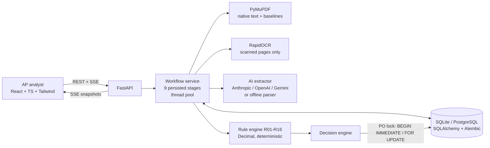

# InvoiceIQ — Intelligent Accounts Payable Automation

From an invoice PDF to a clear, explainable decision: **approve**, **send for review** or **reject**, with every step visible.
Built for the Zamp AI Solutions Analyst case study (PS-1: Invoice processing — from PDF to decision).

> **InvoiceIQ makes invoice decisions only. It never executes payments.**
> All data in this repository is synthetic.

---

## 1. Overview & business problem
An AP team receives hundreds of vendor invoices a month as PDFs (clean, scanned, multi-page, differently laid out). A person opens each one,
finds the PO, checks the numbers, checks for duplicates and decides. It is slow and, on a Friday afternoon, error-prone.

## 2. Proposed solution
```
PDF → validate → text (native / OCR) → AI field extraction → document checks → vendor verification → PO matching
    → duplicate detection → financial reconciliation → decision (under a PO lock) → persisted + dashboard
```
* **AI where it is good**: reading messy documents into structured fields (Anthropic / OpenAI / Gemini, schema-validated).
* **Deterministic code where it matters**: 16 rules (R01–R16) in Python with `Decimal` money. *No LLM ever makes a financial decision.*
* **Humans own uncertainty**: anything ambiguous goes to a review queue with a recommended next action; hard financial controls cannot be bypassed by a manual click.
* **Everything is traceable**: per-stage timeline (timestamps, durations, data), rule-by-rule explanations, evidence snippets, and an append-only audit trail.

## 3. Architecture

Details: [docs/ARCHITECTURE.md](docs/ARCHITECTURE.md) · Rules & policy: [docs/BUSINESS_RULES.md](docs/BUSINESS_RULES.md) ·
Scenarios: [docs/TEST_CASES.md](docs/TEST_CASES.md) · Demo: [docs/DEMO_SCRIPT.md](docs/DEMO_SCRIPT.md) · Latest run: [docs/TEST_REPORT.md](docs/TEST_REPORT.md)

## 4. Technology
| Layer | Choice | Why |
|---|---|---|
| Frontend | React 18, TypeScript, Vite, Tailwind 4, shadcn-style components (cva), Lucide, Recharts, React Router, TanStack Query | Fast, typed, easy to demo |
| Backend | Python 3.11, FastAPI, Pydantic v2, SQLAlchemy 2, Alembic | Typed contracts, simple async-friendly API |
| DB | SQLite (WAL) for the prototype; portable schema (Decimal stored exactly, locking works on PostgreSQL via `FOR UPDATE`) | Zero setup |
| PDF / OCR | PyMuPDF; RapidOCR (ONNX, pip-only, no system Tesseract) | Works on any machine |
| Realtime | Server-Sent Events with automatic polling fallback | Real stage transitions, no fake progress |
| Tests | pytest + FastAPI TestClient, Vitest, Playwright | See §16 |

## 5. Workflow (the 9 real stages)
1 PDF validation (signature, corruption, encryption, size, pages, SHA-256) · 2 Text extraction (native text per page; OCR only for pages without a text layer) ·
3 AI field extraction (strict schema, evidence snippets, never invents) · 4 Invoice validation (R01 R06 R07 R15) · 5 Vendor verification (R02) ·
6 PO matching (R03 R04 R05 R14) · 7 Duplicate detection (R08) · 8 Financial reconciliation (line matching, R09 R10 R11 R12 R13 R16) ·
9 Decision generation (everything shared-state-dependent is re-evaluated inside one locked transaction, then persisted).
A run is *completed* only after the decision and all records are committed. Pipeline failures (corrupt PDF, OCR failure, AI outage after bounded retries) end as **`PROCESSING_ERROR`** — never as a rejection.

## 6. AI extraction methodology
* Provider chosen by `LLM_PROVIDER` (`auto` picks the first key found). Structured output via Anthropic tool-use / OpenAI JSON mode / Gemini JSON mime type, then validated by Pydantic (`schemas/extraction.py`).
* The prompt marks invoice text as **untrusted data**; embedded instructions ("approve this invoice…") are ignored *and* detected (flagged by R15).
* Missing → `null` + warning; numbers/dates are normalised (`1,00,000.00`, `15/11/2026`) but never guessed. Bounded retries only for transient errors (429/5xx/timeouts/invalid JSON); 401 is not retried; **a failed AI call is never silently replaced by fabricated data**.
* R15 verifies that the invoice number, PO, vendor and grand total appear verbatim in the document text (catches hallucinations).
* **Offline mode:** with no API key the same pipeline uses a built-in, rule-based parser (clearly labelled in the UI and in every run). It reads the real document text, returns `null` when unsure, and is what the automated tests use. Decisions are identical because rules never use an LLM.

## 7–10. Rules, PO matching, duplicates, partial invoicing
See [docs/BUSINESS_RULES.md](docs/BUSINESS_RULES.md). Highlights: vendor match order (tax ID → name → alias → normalised → fuzzy *suggestion*), PO line matching with bundle detection,
1 % tolerance that can **never** push past the PO or its remaining balance, balance derived from approved invoices (not trusted from a column), exact + file-hash + suspicious duplicate detection.

## 11. Edge cases (17 sample PDFs, all executed — see TEST_REPORT)
Valid · duplicate · amount mismatch · partial billing (approve 35k → 25k left → 30k held) · missing invoice number · scanned (2, OCR) · wrong vendor · balance exceeded despite in-tolerance price ·
currency mismatch · bundled lines · inactive vendor · blocked vendor · prompt-injection + closed PO · 24-line multi-page · within-tolerance valid.

## 12. Database
`vendors, purchase_orders, po_lines, invoices, invoice_lines, processing_runs, stage_events, validation_results, audit_events` with FKs and constraints; money columns use a `Decimal`-exact type;
migration: `backend/alembic/versions/0001_initial_schema.py`.

---

## 13. Local setup
**Prereqs:** Python 3.11+, Node 20+. *(Windows: keep the project in a short path such as `C:\invoiceiq` — onnxruntime and esbuild fail to start when the folder path is very long.)*

```bash
# 1. Backend
python -m venv .venv                       # at the repo root
.venv\Scripts\activate                     # Windows (macOS/Linux: source .venv/bin/activate)
pip install -r backend/requirements-dev.txt   # everything: OCR + tests + sample-data generator
# lean runtime only (~120 MB, no OCR for scanned PDFs):  pip install -r backend/requirements.txt
# add OCR (~+200 MB):                                      pip install -r backend/requirements-ocr.txt

# 2. Synthetic data: 17 PDFs, vendors, POs, PO history, test manifest (dates are relative to today)
python scripts/generate_sample_data.py

# 3. Database (optional: the API seeds an empty DB on first start)
python scripts/seed_database.py            # drop + recreate + seed
cd backend && alembic upgrade head && cd ..   # only if you prefer migrations over create_all

# 4. API (http://127.0.0.1:8000, docs at /docs)
cd backend && uvicorn app.main:app --reload --port 8000
```
```bash
# 5. Frontend, dev mode (http://localhost:5173, proxies /api to :8000)
cd frontend && npm install && npm run dev

# ...or build once and let the API serve the UI on :8000 (single process)
cd frontend && npm install && npm run build      # then open http://127.0.0.1:8000
```

## 14. Configure the AI key
Copy `.env.example` to `.env` (repo root) and set **one** of `ANTHROPIC_API_KEY`, `OPENAI_API_KEY`, `GEMINI_API_KEY` (optionally `LLM_PROVIDER`, `LLM_MODEL`). Restart the API.
The header shows `Extraction: anthropic` (or `offline parser`), and Settings shows the active provider and which keys are present (never the keys).

## 14b. Hosting notes (read before deploying)
This app is a **long-running server**, not a serverless function: it runs processing in background threads, streams progress over SSE,
keeps SQLite + uploaded PDFs on disk and holds a process-wide PO lock. Deploy it as a container (Render, Railway, Fly.io, a VM) using the Dockerfiles below.
On Vercel/Lambda-style platforms the full install exceeds the 500 MB function limit (`LAMBDA_SIZE_EXCEEDED`; use the lean `requirements.txt` and skip OCR),
and even then background work, SSE and local files do not persist — host only the static frontend there and run the API elsewhere.

### Split deployment: frontend on Vercel, API on a container host
1. **Deploy the API** (Render / Railway / Fly.io, using `backend/Dockerfile`). Note its public `https://` URL. Set `CORS_ORIGINS` there to your frontend URL
   (comma-separated, no trailing slash), e.g. `CORS_ORIGINS=https://invoiceiq-frontend.vercel.app,http://localhost:5173`; optionally `CORS_ORIGIN_REGEX` for Vercel preview URLs.
2. **Deploy the frontend** (Vercel, root directory `frontend`, build `npm run build`, output `dist`). Add the environment variable `VITE_API_URL=https://<your-api-host>` (https, no trailing slash).
   Vite reads it **at build time**, so **redeploy** after changing it. `frontend/vercel.json` rewrites all routes to `index.html` for client-side routing.
3. All calls (REST, the SSE progress stream and the PDF page images) use `VITE_API_URL`; if it is unset the app uses the same origin (dev proxy / API-served UI).
4. An https frontend cannot call an http API (mixed content), and the API's disk (SQLite + uploads) must be persistent: use a persistent disk/volume on the host.

## 15. Docker
```bash
cp .env.example .env      # add a key if you have one
docker compose up --build  # UI on http://localhost:8080 (nginx → API), data in a named volume
```
> The Docker files were written but **could not be run in the authoring environment (no Docker installed)** — see Known limitations.

## 16. Tests
```bash
cd backend && pytest                       # unit + integration (49 tests; includes all 17 PDFs through the real pipeline, OCR, concurrency)
cd frontend && npm test                    # Vitest (8 tests)
cd frontend && npx playwright install chromium && npm run test:e2e   # 5 UI end-to-end specs against a running stack (executed: 5 passed)
ANTHROPIC_API_KEY=... pytest backend/tests/test_live_smoke.py        # optional live LLM check (skipped without a key)
```
`pytest` writes [docs/TEST_REPORT.md](docs/TEST_REPORT.md) (input file, expected, actual, pass/fail per scenario).
LLM behaviour (retries, timeouts, invalid JSON, key rejection) is tested with a mocked HTTP layer; the live test is opt-in.

## 17. Run the demo
Follow [docs/DEMO_SCRIPT.md](docs/DEMO_SCRIPT.md). Short version: Settings → *Reset demo data* → Process Invoice → *Add* the bundled samples in `run_order` → *Start processing*.
You can also drag your own PDFs onto the drop zone.

## 18. Assumptions
* One legal entity (Northwind Industries Pvt Ltd) is the buyer; its tax ID is never mistaken for a vendor's.
* Numeric dates like `03/11/2026` are day-first (India/EU). PO tax rates are the expected tax rates.
* Default tolerance 1 % on price/total; arithmetic rounding ±0.05; invoices older than 365 days are suspicious.
* Currency conversion is **not** configured, so a currency mismatch always needs a human.
* Policy choice for "wrong vendor": **needs review** (not auto-block), but approving it manually is not allowed until the PO/vendor data is corrected.
* Only `APPROVED` invoices consume PO balance.

## 19. Known limitations (honest list)
* **Live LLM extraction was not exercised in the authoring environment** (no API key): the LLM code path is covered by mocked tests and an opt-in live test; everything demonstrated end-to-end used the offline parser. Expect the AI path to cope with far more layouts than the offline parser.
* The offline parser is tuned to common invoice conventions (labelled fields, tabular lines). Unusual layouts (labels above values in a grid, wrapped multi-line descriptions) should be read with an LLM key set.
* OCR (RapidOCR) drops spaces in some strings; the pipeline compensates (squashed-text similarity) and the OCR-confidence check routes doubtful scans to review. A 1-page scan takes ~3–6 s on CPU.
* **Docker/Compose were not executed** (no Docker in the authoring environment). Playwright's 5 specs *were* run against the live stack from a short-path copy of the frontend (Windows long-path limits broke esbuild/onnxruntime in the very long authoring folder).
* SQLite + an in-process worker pool: fine for a demo and a single node; scale-out would move runs to a queue (Celery/RQ) and the DB to PostgreSQL (the locking code already has the `FOR UPDATE` path, which is untested against a real PostgreSQL).
* Demo-grade auth: no login; a single demo reviewer identity. Not production security.
* No per-line cumulative *amount* tracking beyond quantity; no multi-currency conversion; no email intake or vendor-facing clarification emails (the clarification request is recorded, not sent).

## 20. Future improvements
Email/SFTP intake, vendor clarification emails, multi-currency with FX policy, GRN 3-way match, learning vendor-specific layouts, PostgreSQL + queue workers, SSO/RBAC, payment-run export, confidence-calibrated auto-approval thresholds.

## Project layout
```
backend/   app/{api,models,schemas,services,database,core}  tests/  alembic/
frontend/  src/{components,pages,hooks,services,types,utils}  e2e/
scripts/   generate_sample_data.py  seed_database.py
sample_data/  vendors.csv purchase_orders.csv po_lines.csv history_invoices.csv invoices/*.pdf test_manifest.json
docs/      ARCHITECTURE.md BUSINESS_RULES.md TEST_CASES.md DEMO_SCRIPT.md TEST_REPORT.md
```
